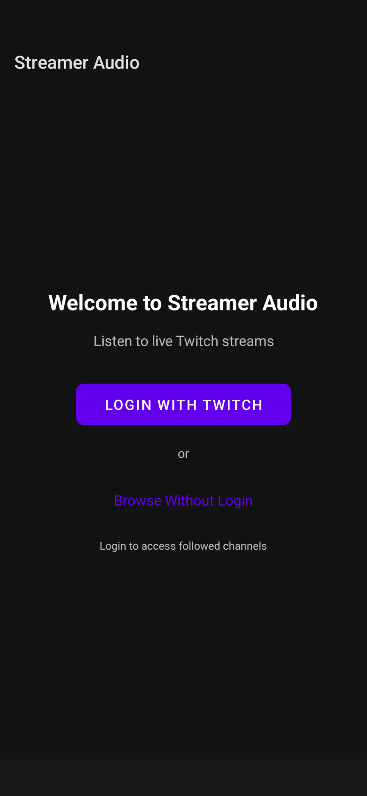
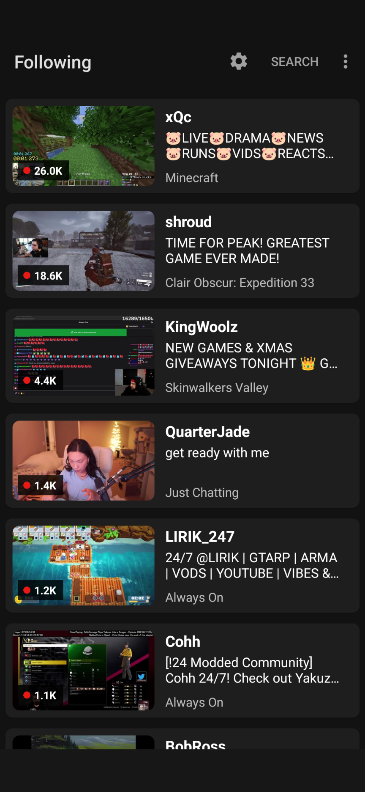
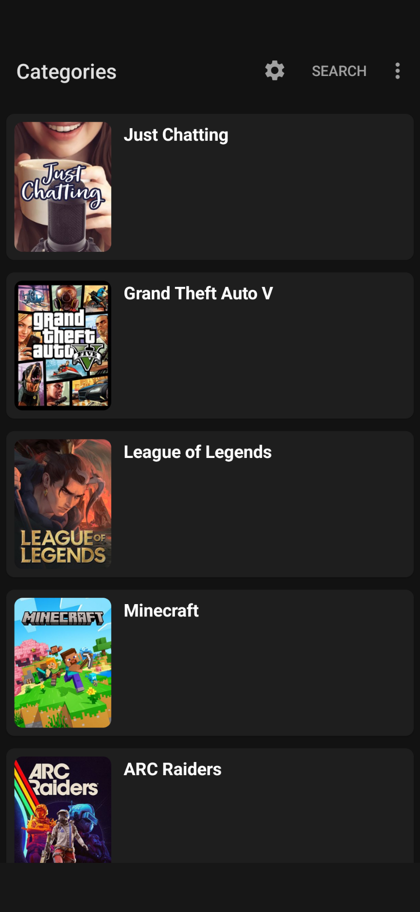
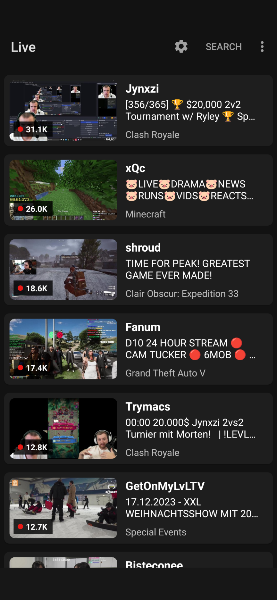
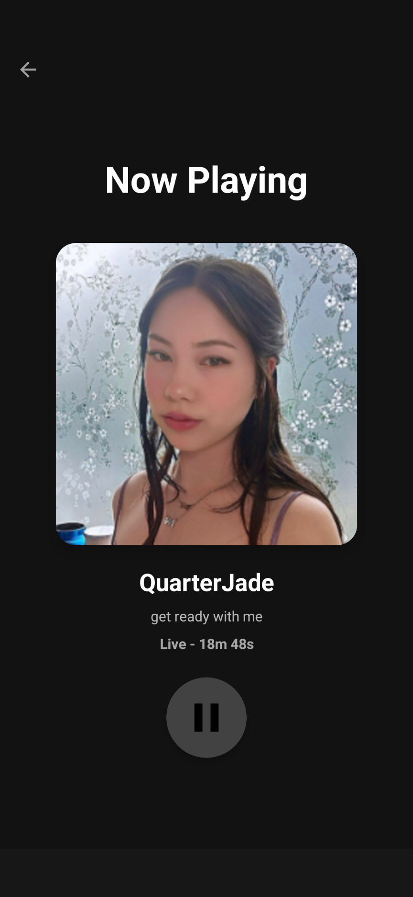
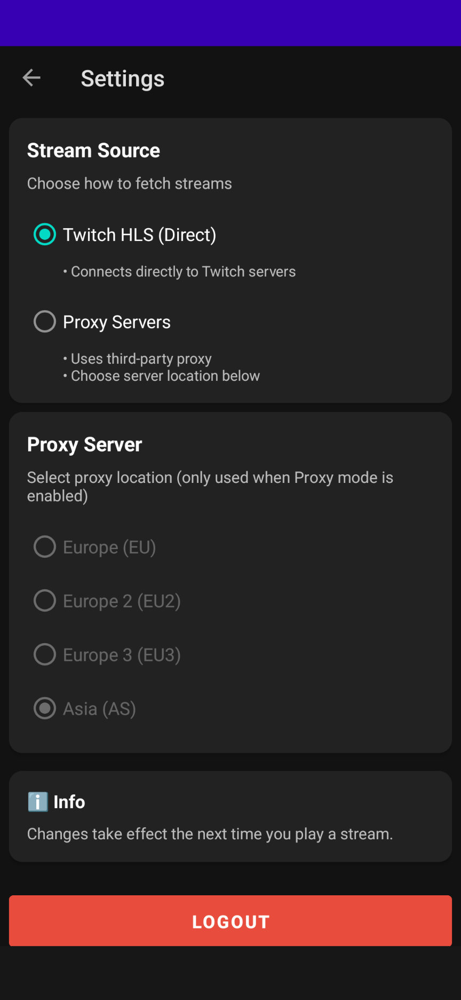
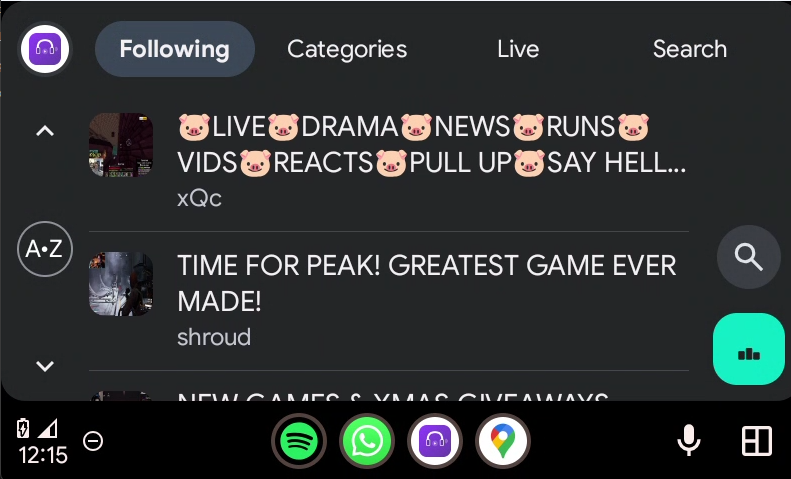
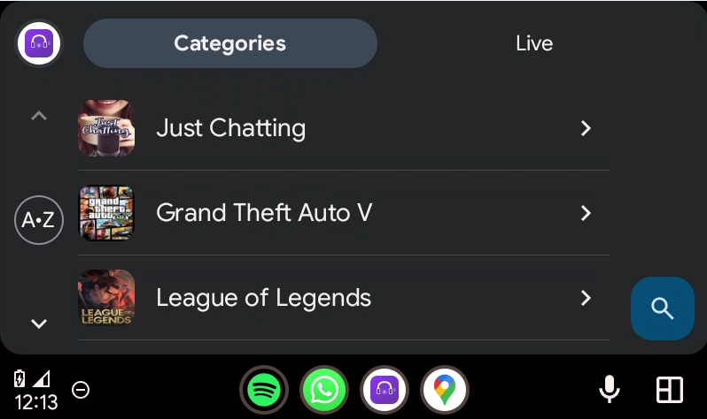
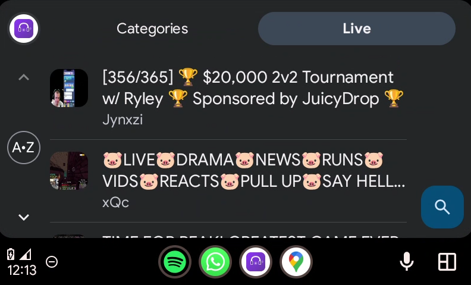
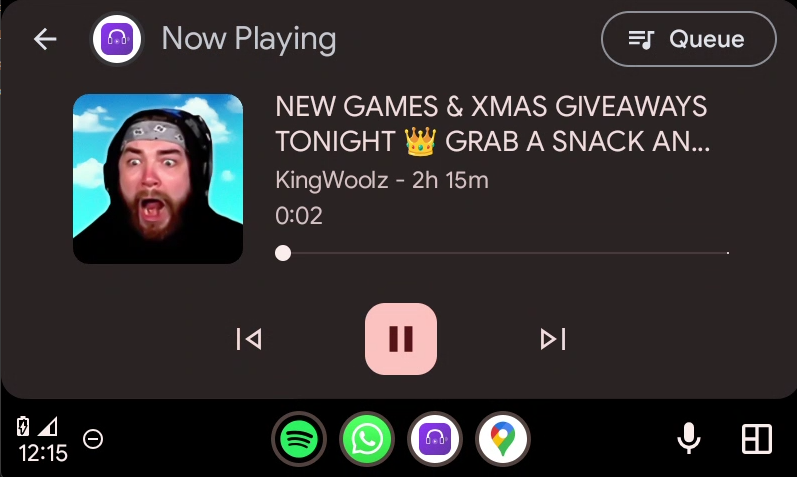

# Streamer Audio

<p align="center">
  
  
  
  
</p>

An Android application that allows users to listen to live Twitch streams as audio-only, perfect for multitasking or saving bandwidth. Supports both authenticated users (with followed channels) and guest browsing.

## 📸 Screenshots

<p align="center">
    
    
    
    
    
        
</p>
<p align="center">

    
    
    
</p>

## ✨ Features

### Core Features
- 🎵 **Audio-only streaming** - Listen to Twitch streams without video
- 👤 **Dual-mode support** - Use with or without Twitch login
- 📱 **Modern UI** - Material Design 3 with dark/light theme support
- 🚗 **Android Auto** - Full Android Auto compatibility for in-car listening
- 🔄 **Infinite scroll** - Seamless pagination across all lists
- 🔍 **Search** - Find live channels (authenticated users)
- 🎮 **Browse categories** - Explore streams by game/category

### Authenticated Users
- Follow live channels you're subscribed to
- Access your followed streamers
- Search for specific channels
- Full Twitch OAuth integration

### Guest Users
- Browse top categories/games
- View live channels by category
- Explore top live streams
- No login required

### Playback Options
- **HLS Direct Streaming** - Direct connection to Twitch servers
- **Proxy Servers** - Alternative streaming via proxy (EU/Asia regions)
- **Automatic fallback** - Switches to proxy if HLS fails
- **Audio-only optimization** - Extracts audio stream for lower bandwidth

### UI Features
- Mini player with now playing controls
- Pull-to-refresh on all lists
- Live viewer counts and uptime display
- Streamer profile images
- Stream thumbnails
- Material Design card-based layout

## 🏗️ Architecture

The app follows Clean Architecture principles with MVVM pattern:

```
├── data/
│   ├── api/              # Retrofit API services
│   ├── datasource/dto/   # Data Transfer Objects
│   ├── repository/       # Repository implementations
│   └── util/            # Utilities and constants
├── domain/
│   ├── repository/      # Repository interfaces
│   └── usecase/         # Business logic use cases
├── presentation/
│   ├── ui/              # Activities and UI components
│   ├── adapter/         # RecyclerView adapters
│   ├── viewmodel/       # ViewModels
│   └── di/              # Dependency injection modules
└── service/             # Media playback services
```

## 🛠️ Tech Stack

### Core Technologies
- **Language**: Kotlin
- **Min SDK**: 24 (Android 7.0)
- **Architecture**: MVVM + Clean Architecture
- **DI**: Hilt/Dagger

### Key Libraries
- **Media3** - Modern media playback (ExoPlayer)
- **Retrofit** - REST API client
- **OkHttp** - HTTP client
- **Glide** - Image loading
- **Coroutines & Flow** - Asynchronous programming
- **Material Components** - UI design
- **SwipeRefreshLayout** - Pull-to-refresh
- **EncryptedSharedPreferences** - Secure token storage

### APIs
- **Twitch Helix API** - Stream data for authenticated users
- **Twitch GraphQL API** - HLS token generation
- **Custom Backend API** - Unauthenticated browsing endpoints

## 📋 Prerequisites

- Android Studio (Hedgehog or newer recommended)
- JDK 11 or higher
- Android SDK 24+
- Twitch Developer Application (for OAuth)

## 🚀 Getting Started

### 1. Clone the Repository

```bash
git clone https://github.com/satpal123/StreamerAudio.git
cd StreamerAudio
```

### 2. Twitch API Setup

1. Create a Twitch Developer account at [dev.twitch.tv](https://dev.twitch.tv)
2. Register a new application
3. Set redirect URI to `http://localhost`
4. Copy your Client ID

### 3. Configure API Keys

In `app/src/main/java/com/player/streameraudio/data/util/Constants.kt`, update:

```kotlin
const val TWITCH_CLIENT_ID = "your_client_id_here"
```

### 4. Backend API (Optional)

The app uses a custom backend for unauthenticated browsing. The backend is already configured at:
```
https://streameraudio-twitch-backend.netlify.app/.netlify/functions/
```

If you want to host your own backend, you'll need these endpoints:
- `GET /categories` - Returns top games/categories with pagination
- `GET /channels?game_id=X` - Returns live channels for a game
- `GET /top-streams` - Returns top live streams
- `GET /profile-image?login=X` - Returns user profile data

### 5. Build and Run

```bash
# Open in Android Studio and sync Gradle
# Or use command line:
./gradlew assembleDebug

# Install on connected device:
./gradlew installDebug
```

## 📱 Usage

### First Launch

1. **With Login**: Click "Login with Twitch" to access followed channels
2. **Without Login**: Click "Browse Without Login" to explore as guest

### Navigation

- **Following** - Your followed live channels (authenticated only)
- **Categories** - Browse streams by game/category
- **Live** - Top live streams across Twitch
- **Search** - Find specific channels (authenticated only)

### Settings

Access settings via the toolbar menu (⚙️):
- **Stream Source**: Choose between HLS Direct or Proxy
- **Proxy Server**: Select region (EU/EU2/EU3/AS)
- **Logout**: Clear authentication and return to guest mode

### Playback

- Tap any stream to open the full player
- Use the mini player bar (bottom) to control playback from any screen
- View live uptime and viewer count
- Android Auto: Full browse and playback support in compatible vehicles

## 🔧 Configuration

### Stream Source Options

**HLS Direct** (Default for authenticated users):
- Connects directly to Twitch's servers
- Requires Twitch Client-ID
- May fail if GraphQL API restrictions change

**Proxy Mode** (Default for guest users):
- Routes through third-party proxy servers
- More reliable long-term
- Choose closest server for best performance

### Proxy Servers

- **EU** - Europe (Primary)
- **EU2** - Europe (Secondary)
- **EU3** - Europe (Tertiary)
- **AS** - Asia

## 🔒 Security

- OAuth tokens encrypted using `EncryptedSharedPreferences`
- No plaintext credential storage
- Secure HTTPS connections only
- WebView data cleared after logout
- Access tokens validated on app launch

## 🎯 Roadmap

Future enhancements planned:

- [ ] Favorites/bookmarks for guest users
- [ ] Playback history
- [ ] Sleep timer
- [ ] Chromecast support
- [ ] Equalizer integration

## 🐛 Known Issues

- HLS mode may occasionally fail due to Twitch API changes (use Proxy mode as fallback)
- Android Auto search not implemented yet
- Some thumbnails may take time to load on slow connections

## 🤝 Contributing

Contributions are welcome! Please feel free to submit a Pull Request.

### How to Contribute

1. Fork the repository
2. Create your feature branch (`git checkout -b feature/AmazingFeature`)
3. Commit your changes (`git commit -m 'Add some AmazingFeature'`)
4. Push to the branch (`git push origin feature/AmazingFeature`)
5. Open a Pull Request

### Development Guidelines

- Follow Kotlin coding conventions
- Maintain Clean Architecture pattern
- Add unit tests for new features
- Update README if adding new functionality
- Test on multiple Android versions

## 📄 License

This project is licensed under the MIT License - see the [LICENSE](LICENSE) file for details.

## ⚠️ Disclaimer

This app is not affiliated with, endorsed by, or sponsored by Twitch Interactive, Inc. All Twitch-related trademarks and logos are property of Twitch Interactive, Inc.

The app is intended for personal use and should respect Twitch's Terms of Service.

## 🙏 Acknowledgments

- [Twitch API](https://dev.twitch.tv/docs/api/) - Stream data and authentication
- [Media3/ExoPlayer](https://developer.android.com/guide/topics/media/media3) - Audio playback engine
- [Luminous Proxy](https://luminous.dev) - Proxy server infrastructure
- Twitch community for testing and feedback

## 📊 Project Stats

- **Lines of Code**: ~5000+
- **Languages**: Kotlin, XML
- **Activities**: 4
- **ViewModels**: 5
- **Use Cases**: 12
- **API Services**: 4

## 📞 Support

If you encounter any issues or have questions:

1. Check the [Issues](https://github.com/yourusername/streamer-audio/issues) page
2. Create a new issue with detailed description
3. Include Android version, device model, and steps to reproduce

## 🗺️ Future Vision

The goal is to create the best audio-only Twitch experience on Android, with features rivaling dedicated podcast apps while maintaining the live, interactive nature of Twitch streams.

---

<p align="center">Made with ❤️ for the Twitch community</p>
<p align="center">⭐ Star this repo if you find it useful!</p>
<p align="center">
  ☕ Enjoying the app? <a href="https://ko-fi.com/satpal123">Support the project on Ko-fi</a>
</p>
